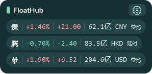

# FloatHub

FloatHub 是 Windows x64 桌面悬浮组件。首个模块使用腾讯财经报价显示自选股。应用、设置和托盘均使用中文。



## 开始使用

- 使用**免安装版**时，直接运行 `artifacts/win-x64/FloatHub.exe`。程序内含 .NET 桌面运行时。
- 使用**安装版**时，双击 `artifacts/FloatHub-1.0.2-x64.msi`，安装完成后从开始菜单打开 FloatHub。默认安装到当前用户的 `%LOCALAPPDATA%\Programs\FloatHub`。卸载入口在 Windows 的“应用和功能”或“已安装的应用”。
- 首次启动在主屏幕右下角显示贵州茅台、腾讯控股和苹果。三个初始自选都可以移除。所有数字均从接口获取，首次离线时显示横线。无需注册、API Key 或管理员权限。

## 悬浮窗口

| 操作 | 结果 |
| --- | --- |
| 拖动标题或胶囊 | 移动悬浮窗。齿轮和滚动条保留各自的操作。 |
| 拖到工作区任一边缘并松手 | 在约 12 个逻辑像素内吸附，滑动收起，仅留展开把手。工作区避开任务栏。 |
| 悬停把手，再移开鼠标 | 临时展开，离开约 560 毫秒后收起。展开时立即请求报价。 |
| 将把手或临时展开的窗口拖离边缘并松开 | 固定在新位置，之后移开鼠标仍保持展开。 |
| 右键“收纳 / 固定展开” | 手动停靠到最近边缘，或退出收纳。 |
| 悬停胶囊 | 查看证券简称、代码、交易所、交易时段、报价时间、时区和数据状态。 |
| 关闭悬浮窗 | 隐藏至托盘。双击托盘图标可恢复，再次启动程序也可找回设置。 |
| 托盘右键“退出 FloatHub” | 结束程序。 |

股票较多时可以在悬浮窗内滚动。桌面坐标按显示器工作区保存，程序会在分辨率变化时重新约束窗口。已保存的显示器断开后回到主屏幕。

## 设置

**股票管理**支持名称、拼音、代码和市场筛选。输入后按 Enter，双击结果或点“添加到自选”。精确代码支持 `sh600519`、`bj920002`、`hk00700`、`usBRK.B` 等写法。选择自选股即可上移、下移、改名或移除。自定义名称留空时，使用证券简称中的首个文字或字母。

沪深场内 ETF 也可以添加到自选。例如，在“全部市场”或“上交所”输入 `513330`、`恒生互联网ETF华夏` 或 `恒生互联网ETF华夏513330`，即可找到这只基金。

指数可按名称或代码添加，例如“上证指数”（`sh000001`）、“恒生指数”（`HSI`）、“纳斯达克100指数”（`NDX`）。选择“指数”可只看指数结果。悬停已添加的指数可查看点位和行情时间。

**行情显示**可选择涨跌幅、涨跌额和成交额，至少保留一项。各项可独立排序和设置 0 至 4 位小数。支持万、亿缩写和原币金额。涨跌额为现价减昨收，涨跌幅为涨跌额除以昨收乘以 100%。所有市场统一红涨绿跌。设置中的胶囊预览使用第一只自选股的实际报价。

**数据设置**提供 15 秒、30 秒、60 秒和 5 分钟刷新间隔，默认 30 秒。页面显示连接状态和最近成功连接的时间，胶囊详情显示该证券自己的行情时间。模块停用、窗口收纳或隐藏后停止调度。网络异常时保留最后有效报价并标出过期缓存。

**常规设置**可调整置顶、透明度、自动收纳和开机启动，或将窗口移回主屏右下角。开机启动使用当前用户“启动”文件夹中的快捷方式。移动免安装版文件后，重新关闭并开启此选项以更新快捷方式。

**模块管理**控制股票追踪模块。模块关闭后可继续从托盘进入设置。

## 本地数据与备份

SQLite 文件位于 `%LOCALAPPDATA%\FloatHub\floathub.db`，保存窗口位置、收纳模式、模块开关、自选股、别名、顺序、显示参数、刷新配置和最近成功的行情。配置按修改自动提交。腾讯接口无需保存凭据。

在“常规设置”选择“备份配置与自选股”，可在程序运行时导出一致的 SQLite 副本。恢复时先从托盘退出，保留原数据库的备份，再将导出文件复制为上述路径的 `floathub.db`。开机启动由当前 Windows 用户的快捷方式决定，迁移到另一台电脑后可在常规设置中开启。

日志保存在同一目录下的 `logs` 中，采用 JSON Lines，按日期和大小滚动。安装版卸载后保留此数据目录。

## 行情覆盖与验收

七个目标交易所均有联网成功样本。腾讯公开端点的请求配额、实时性承诺、商业展示和再分发许可仍需供应方确认。港股使用普通延时报价。市场时段按交易所日历推算，可能与个股停牌、临时休市或特殊交易安排有差异。[行情字段、日历与边界](docs/行情数据.md) · [测试记录](docs/验收记录.md)

## 构建和运行

开发环境为 Windows x64 和 .NET 10 SDK。Windows 自带 `winsqlite3.dll` 提供 SQLite。运行项目只需要 .NET 桌面框架依赖，首次打包 MSI 时脚本会在项目工具目录还原 WiX 4.0.6。

```powershell
dotnet build FloatHub.slnx -c Release
dotnet run --project src/FloatHub -c Release
.\build.ps1
```

只构建自包含 EXE 可运行 `.\build.ps1 -SkipInstaller`。完整发布输出在 `artifacts`，包括 win-x64 单文件程序和当前用户 MSI 安装包。

```powershell
dotnet run --project tests/Checks -c Release
dotnet run --project tests/Checks -c Release -- --live --desktop
powershell.exe -File tests/smoke-package.ps1
```

第一条为离线测试。第二条会访问腾讯接口、打开真实 WPF 测试窗口，并短暂移动和恢复鼠标。第三条在干净的 Windows 测试账户验证已经生成的安装包，涉及当前用户安装、快捷方式和卸载。

## 源码结构

| 位置 | 职责 |
| --- | --- |
| `src/FloatHub` | 应用入口、原生窗口定位、收纳动画、托盘、开机启动、设置导航和模块注册。 |
| `src/FloatHub.Core` | 模块生命周期、SQLite、备份、滚动日志、停靠几何及共用主题。 |
| `src/FloatHub.StockTracker` | 腾讯数据服务、解析、市场日历、调度、视图模型、胶囊与模块设置页面。 |
| `installer`、`build.ps1` | 自包含发布和 WiX 安装包。 |
| `tests` | 数据、持久化、调度、联网、桌面交互及成品验收。 |
| `licenses` | 随同可执行文件嵌入的 .NET 运行时许可与第三方声明。 |

新增模块可实现 `IDesktopModule`，提供视图、设置页及启停和释放逻辑，并在应用组合入口 `RegisterModules` 注册。行情供应方可替换 `IQuoteService` 实现。胶囊外观由 `CapsuleTemplate` 数据模板控制。
